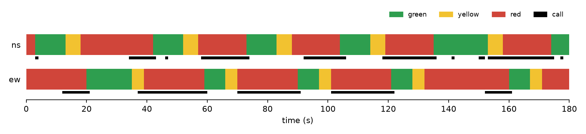
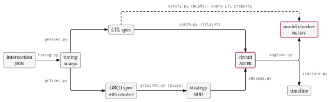

# Traffic signal controller synthesis

Automatically construct a traffic signal controller from a temporal-logic specification, then check it with an independent model checker. Final project for CS 591 (Fall 2026), topic "Controller Synthesis for a Traffic Light".

The timing in the specification comes from transportation standards: ITE yellow and red clearance formulas, the MUTCD yellow range, and NEMA dual-ring phasing.



## What it shows

- **Two synthesis tools agree.** Spot's `ltlsynt` (full LTL) and Slugs (GR(1)) work from separately written encodings and give the same answer on every case tested.
- **The controller is checked independently.** Every LTL property is model-checked with NuSMV on the synthesized circuit. This is complete for the two-phase and four-phase intersections; for six phases NuSMV proved only part of the properties within its limits, and the eight-phase circuit was not model-checked ([`results/scaling.tsv`](results/scaling.tsv)).
- **Synthesis reaches the NEMA eight-phase dual ring** ([`figures/timeline_nema8.png`](figures/timeline_nema8.png)), in seconds.
- **The smallest guaranteed waiting time equals the hand formula:** minimum cycle length minus the shortest minimum green ([`results/minwait.tsv`](results/minwait.tsv), [`figures/realizability_map.png`](figures/realizability_map.png)).
- **Assumptions matter, and can be tested.** Dropping one makes the spec unrealizable ([`results/assumptions.tsv`](results/assumptions.tsv)).
- **A real signal was used to test the model's assumptions.** One hour of public UDOT data confirms the timing assumptions and refutes the assumption that detector calls persist ([`results/udot7185_checks.tsv`](results/udot7185_checks.tsv)).

## Quick start

Everything executes in a container with Spot, Slugs, NuSMV and Typst installed.

```sh
docker compose build
docker compose run --rm dev make                  # two-phase intersection, end to end
docker compose run --rm dev make MAX_WAIT=24      # with a 24 s waiting bound
docker compose run --rm dev make I=nema8 STEP=2   # NEMA eight-phase, 2 s steps
docker compose run --rm dev make test
```

`make` writes into `build/`: the timing, both specs, the strategy, the circuit (`.aag`), the NuSMV model, the verification table (`.verify.tsv`) and a simulated timeline (`.png`).

The container is capped at 10 GB of memory and 4 cores (`MEM_LIMIT` and `CPUS` change that). Model checking can use several gigabytes per process; `JOBS` sets how many execute at once (default 2).

## Pipeline



Each box is a file and each arrow is a small command-line tool or a solver. The intersection description is turned into interval lengths (`timing.py`), then into two specifications of the same rules: one in linear temporal logic (LTL) for `ltlsynt`, one in Generalized Reactivity(1) form, GR(1), for Slugs. Both routes end in a circuit in the AIGER format. NuSMV, a model checker that shares nothing with the synthesizers, then checks every LTL property on that circuit, and `simulate.py` executes the circuit on random inputs to draw a timeline.

Each tool reads a file or stdin and writes stdout, so they can be piped:

```sh
cd tools
python3 timing.py ../intersections/two_phase.json --step 1 > t.json
python3 gr1spec.py t.json --max-wait 24 | python3 gr1synth.py | python3 bdd2aag.py > c.aag
python3 arrivals.py call_ns=0.1 call_ew=0.05 --steps 120 \
  | python3 simulate.py c.aag --lock | python3 plot_timeline.py -o timeline.png
python3 aag2smv.py c.aag > c.smv
python3 genspec.py t.json --max-wait 24 > spec.json
python3 verify.py c.smv spec.json
```

| Script file | Job |
|---|---|
| `timing.py` | intersection description → interval lengths in seconds and steps |
| `genspec.py` | timing → LTL spec (JSON of named formulas) |
| `gr1spec.py` | timing → the same rules as a GR(1) spec for Slugs |
| `synth.py`, `gr1synth.py` | invoke `ltlsynt` / Slugs; `--check` only decides realizability |
| `minwait.py` | smallest realizable waiting bound, by bisection |
| `bdd2aag.py` | Slugs strategy → AIGER circuit |
| `aag2smv.py`, `spec2smv.py` | circuit / spec → NuSMV |
| `verify.py` | model-check every property; prints name, verdict, seconds |
| `smvtrace.py` | NuSMV counterexample → CSV |
| `arrivals.py`, `simulate.py`, `plot_timeline.py` | random inputs → execute a circuit → draw the timeline |
| `logintervals.py`, `checklog.py`, `log2timeline.py`, `stats.py` | work with controller event logs |

Spec options (both generators): `--max-wait S` bounds the waiting time, `--locking` assumes calls persist and promises a green to every call, `--extend` forbids cutting off a green that has demand, and `--drop PREFIX` removes rules by name.

## Layout

```
intersections/   two_phase, four_phase, six_phase, nema8 (speeds, widths, minimum greens, conflicts)
tools/           the pipeline
baselines/       hand-written fixed-time controllers, one with a clearance bug
experiments/     scripts that produce results/ and figures/
data/udot7185/   one hour of events from a real signal, and how it was fetched
results/         tables from the experiments
figures/         plots
docs/            report (Typst) and slides (LaTeX); not kept in git
tests/           pytest
RUNTIMES.md      machine, tool versions and measured execution times
```

## Reproducing the results

```sh
docker compose run --rm dev make experiments      # slow: see experiments/run_all.sh
```

Every solver invocation in the experiments has a time and memory limit, and an invocation that hits one is reported as `timeout` or `fail` in the table, not dropped.

## Data

`data/udot7185/events.csv` is one hour (17 Oct 2017, 17:00–18:00) of high-resolution controller events for UDOT signal 7185, taken from the unit-test data of the open-source [ATSPM](https://github.com/udotdevelopment/ATSPM) repository (Apache-2.0) and converted from XML to CSV by `data/udot7185/fetch.sh`. Event codes follow the Indiana enumerations.

## Limits

- Independent verification is complete only up to four phases (see above).
- Time is discrete; intervals are rounded up to whole steps.
- Synthesis guarantees correctness, not low delay. No delay comparison was made.
- Pedestrian phases, preemption and coordination are not modelled.
- Minimum greens are design choices, not derived from detector layout.
- Sources of the timing rules: the change-interval formula and its constants are Equation 5-2, and the minimum-green ranges Table 5-3, of the FHWA [Traffic Signal Timing Manual](https://ops.fhwa.dot.gov/publications/fhwahop08024/chapter5.htm) (2008); the 3 to 6 s yellow range is MUTCD 11th edition, Section 4F.17. Newer guidance (NCHRP Report 812, ITE 2020) was not consulted.

## Licence

MIT for the code in this repository. Slugs, Spot, NuSMV and CUDD are installed in the container under their own licences.
